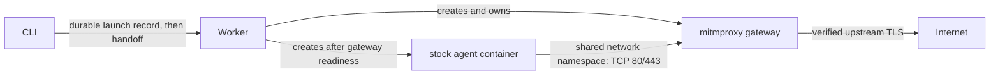

# Web fixture inputs

Use the same named input for local and hosted runs:

```json
{
  "version": 2,
  "inputs": {
    "docs": { "type": "web-fixture", "path": "fixtures/docs.json" }
  }
}
```

The JSON file uses the existing version 1 fixture format:

```json
{
  "version": 1,
  "pages": [
    {
      "url": "https://docs.example.com/guide",
      "contentType": "text/html",
      "body": "<h1>Candidate documentation</h1>"
    }
  ],
  "scopes": ["https://docs.example.com/guide"]
}
```

Select it with a case's `config.inputs: [docs]`. Omitting `config.inputs`
selects all named inputs; `inputs: []` selects none.

```sh
gauge run --verify --local
gauge local runtime pull
gauge run --dry-run --local -o json
gauge run --local
gauge run --local --input docs=fixtures/candidate.json
# The same input contract on a compatible hosted backend:
gauge run --hosted --input docs=fixtures/candidate.json
```

`--verify` validates project files without Docker. `--dry-run` validates and
snapshots selected files, reports conflicts and image availability, and starts
no containers. A launch takes its own immutable snapshot. Local preview JSON
includes each case's fixture digest, page URLs, scopes, and origin mappings;
the attempt's session specification retains the compiled fixture and digest.
Input archive digests are retained in the normal input provenance on both backends.

For a live preview, use an origin mapping instead of pages on that origin:

```json
{
  "version": 1,
  "origins": [
    {
      "origin": "https://docs.example.com",
      "upstream": "https://candidate.example.net"
    }
  ]
}
```

The gateway changes the upstream origin, Host header, and TLS server name.
It preserves the request method, encoded path, query, body, and response stream.
It verifies the upstream's certificate. Response bodies, redirects, cookies,
and embedded absolute URLs are passed through unchanged, so previews should
serve content compatible with the canonical site URL.

## Contract

| Field | Meaning |
| --- | --- |
| `version` | Must be `1`. |
| `pages` | Exact URL replacements for GET/HEAD. `status` defaults to 200; `contentType` defaults to `text/html`; `body` is UTF-8 text. |
| `scopes` | A path and its descendants must have a captured page. Missing content never falls back to the live site. Each scope needs a page on its origin. |
| `origins` | Map a complete HTTPS origin to another HTTPS origin, preserving paths and queries. |
| `searches` | Omit or supply `[]`; search mocks are not supported. |

URLs must use HTTPS, without credentials or custom ports. Page queries match
exactly; fragments are discarded. Scopes have no query or fragment. Origins
have no path. At least one page or origin mapping is required. Files and merged
fixtures are limited to 1 MB. Statuses must be 200–599; 204, 205, and 304 require
an empty body. Content types must be printable ASCII.

Inputs selected together must not declare duplicate pages, overlapping scopes,
or an origin mapping overlapping pages/scopes/another mapping. Conflicts fail
before execution; ordering does not resolve them. Unknown fields, arbitrary
body transformations, and separate URL rewrite rules are rejected.

Outside declared routes traffic passes through. Non-GET/HEAD requests are not
page replacements; scopes still block them when there is no supported response.
Local synthetic replies reject body-bearing requests by closing the flow
without buffering the upload. Ordinary uploads, downloads, SSE, and origin
proxy responses stream through the gateway.

Git and Actions sources use the existing file-input machinery. Interactive CLI
runs package working-tree files or `--input` overrides. Local execution needs
every selected fixture supplied locally; resolving GitHub deployments and PR
comments remains hosted-only. Existing `website` inputs retain their hosted
preview resolution and produce the same origin mappings as `web-fixture` inputs.

## Local implementation and lifecycle

Only sessions selecting a web fixture use a gateway. Other local sessions keep
their existing Docker networking.



The worker owns startup, monitoring, and teardown. The CLI records all container
names before handing off; the parent never creates session containers. The CLI's
existing runtime compatibility probe remains a separate, credential-free preflight.
Session startup is
sequential: gateway configuration, namespace rules and readiness, public CA
distribution, then workload startup. A stopped, networkless helper container
provides the selected workload image's existing CA store and is immediately
removed. It never executes a process or receives credentials.

The workload runs no routing agent, init script, or privileged helper. Docker
joins it to the gateway's network namespace. The gateway installs namespace-only
iptables rules and drops privileges before starting mitmproxy. The workload
has all Linux capabilities dropped and cannot gain privileges. Proxy UID 65532
is reserved and cannot be the host workload UID.

The public CA and combined trust bundle are mounted read-only. The runtime's
existing public roots are preserved; Node and common language/tool CA variables
point to the appropriate public certificates. The private CA key stays in the
gateway container's filesystem and is destroyed with that container.

Neither container restarts automatically. Gateway loss or an uncheckable gateway
ends the attempt. There is no reconnection, config reload, or prompt replay.
Cancellation joins pending startup work before removing resources. Cleanup removes
the workload, gateway, and trust helper before deleting temporary credentials.
It checks container ownership and tolerates already-absent resources. A failed
cleanup retains `cleanupPending` and the launch record for explicit retry through
the normal local cancel/cleanup commands. A fresh rerun uses new identities.

`gateway.log` in the session directory records fixture hits, scoped misses, and
origin rewrites, along with proxy diagnostics. It records no request/response
bodies or authorization headers. The retained log is bounded to the last 10,000
lines. Private certificates are not retained as artifacts.

## Boundaries and development

Interception covers HTTP/TLS over TCP ports 80 and 443. IPv6 is disabled in the
shared namespace, and UDP 443 is rejected to encourage clients to fall back from
QUIC to TCP. Loopback is excluded so stock harness control servers continue to
work. This is a fixture mechanism, not a general network isolation boundary.
Custom certificate stores, certificate pinning, and nonstandard TLS ports are
outside this initial contract.

The original hostname must resolve before a client connects; a synthetic page
does not provide DNS. Use existing public hostnames for normal CLI runs. Local
Docker must support shared Linux network namespaces, NET_ADMIN for the gateway,
and host bind mounts. A setup failure stops before the agent starts. The
qualification workflow tests native Linux amd64 and arm64; Docker Desktop needs
separate qualification before claiming platform parity.

Build and test from the repository root:

```sh
docker build -t ghcr.io/gauge-sh/gauge-gateway:0.1.0 packages/local/gateway
# Use the supported runtime as the fixture workload's base:
docker tag "$(node -p 'const m=require("./cli/runtime-manifest.json"); `${m.repository}@${m.digest}`')" gauge-runtime:dev
docker build -t gauge-session-fixture:test packages/local/test/runtime-fixture
npm run build
GAUGE_DOCKER_FIXTURES=1 npx vitest run packages/local/test/gateway.it.test.ts packages/local/test/lifecycle.it.test.ts
```

`--gateway-image` selects a development/custom image carrying contract label
`sh.gauge.contract=gateway-1`; launch freezes the resolved image ID. The public
gateway is released independently of the agent runtime. A `gateway-vX.Y.Z` tag
qualifies both native architectures, publishes an immutable index, and verifies
anonymous consumption. Commit the resulting qualified gateway manifest before
releasing the CLI. The CLI release check rejects an unpinned gateway manifest.
See [RELEASING.md](../RELEASING.md#gateway).
