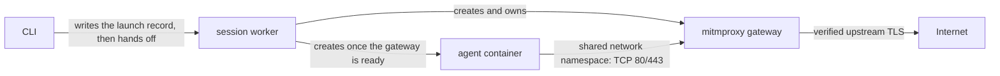

# Web fixture inputs

A web fixture controls what an agent receives when it fetches specific HTTPS
URLs during a session. Use one to test changes to content an agent encounters,
such as a docs page, without publishing them first. A fixture can:

- **Replace pages**: serve exact content for specific URLs.
- **Scope a site section**: return 404 for any page under a path prefix that
  the fixture doesn't provide, instead of falling back to the live site.
- **Route an origin**: send every request for one origin to another, such as a
  preview deployment.

The agent requests the real URL and sees the fixture's response. It needs no
proxy settings, and its prompt doesn't have to mention the fixture.

The same input works in local and hosted runs.

## Quick start

Write the fixture as JSON, for example `fixtures/docs.json`:

```json
{
  "version": 1,
  "pages": [
    {
      "url": "https://docs.example.com/guide",
      "contentType": "text/html",
      "body": "<h1>Candidate documentation</h1>"
    }
  ],
  "scopes": ["https://docs.example.com/guide"]
}
```

Declare it as a named input in `gauge.json`:

```json
{
  "version": 2,
  "inputs": {
    "docs": { "type": "web-fixture", "path": "fixtures/docs.json" }
  }
}
```

Cases select it with `config.inputs: [docs]`. A case without `config.inputs`
selects every named input, and `inputs: []` selects none.

```sh
gauge run --verify --local          # check the project files; no Docker needed
gauge local runtime pull            # download the runtime and gateway images
gauge run --dry-run --local -o json # show each case's fixture routes and digest
gauge run --local
gauge run --local --input docs=fixtures/candidate.json  # use a different file
gauge run --hosted --input docs=fixtures/candidate.json
```

Each launch takes its own snapshot of the selected fixture files. Editing a
file after launch doesn't affect running sessions. The dry run reports each
case's fixture digest, page URLs, scopes, and origin mappings without starting
any containers. Each attempt's session spec records the fixture it used and
its digest.

For a runnable end-to-end example, see
[`examples/web-fixture`](../examples/web-fixture/README.md).

## Routing an origin to a preview

To send all traffic for a site to a preview deployment, map its origin instead
of listing pages:

```json
{
  "version": 1,
  "origins": [
    {
      "origin": "https://docs.example.com",
      "upstream": "https://candidate.example.net"
    }
  ]
}
```

The gateway sends each request to the upstream with the same method, encoded
path, query, and body, and streams the response back. It sets the Host header
and TLS server name to the upstream's and verifies the upstream's certificate.
Response bodies, redirects, cookies, and absolute URLs inside pages pass
through unchanged, so the preview should serve content that works under the
original site's URL.

## Fixture format

| Field | Meaning |
| --- | --- |
| `version` | Must be `1`. |
| `pages` | Exact responses for GET and HEAD requests. Each page has a `url` and `body` (UTF-8 text), plus an optional `status` (default 200) and `contentType` (default `text/html`). |
| `scopes` | URL prefixes where every page must come from the fixture. A request for a missing page under a scope gets a 404; it never reaches the live site. Each scope needs at least one page on the same origin. |
| `origins` | Map one HTTPS origin to another, preserving paths and queries. |
| `searches` | Not supported. Omit it or use `[]`. |

Rules:

- URLs must use HTTPS, with no credentials or custom ports.
- Page URLs match exactly, including the query. Fragments are ignored.
- Scopes have no query or fragment, and origins have no path.
- A fixture needs at least one page or origin mapping.
- Each file, and the combined fixture for a case, is limited to 1 MB.
- `status` must be 200–599. Statuses 204, 205, and 304 require an empty body.
- `contentType` must be printable ASCII.
- Unknown fields are rejected. Fixtures replace whole responses; they don't
  modify live responses or define separate URL rewrite rules.

### Combining inputs

When a case selects several fixture inputs, they are combined into one fixture
for that case. The run fails before any session starts if two inputs conflict:
duplicate pages, overlapping scopes, or an origin mapping that overlaps another
mapping, a page, or a scope. Input order never resolves a conflict.

### Requests outside the fixture

Traffic that matches no page, scope, or origin mapping passes through to the
live site unchanged, including uploads, downloads, and streaming responses
such as server-sent events.

Requests other than GET and HEAD are never served from pages. Under a scope,
they get a 404 like any other missing page. A request with a body that would
receive a fixture response is closed without reading the upload.

### Sources

Fixture files are read like other file inputs: from the working tree in
interactive runs, from `--input` overrides, or from a Git or GitHub Actions
source. Local runs need every selected fixture available as a local file.

`website` inputs, which resolve a preview from a GitHub deployment or PR
comment, remain hosted-only. They produce the same kind of origin mapping as a
`web-fixture` input.

## How local runs serve fixtures

Only sessions that select a web fixture use a gateway; other local sessions
keep their normal Docker networking.



Each session gets its own gateway container running
[mitmproxy](https://mitmproxy.org/). The agent container joins the gateway's
network namespace. Inside that namespace, the gateway redirects outbound TCP
ports 80 and 443 to mitmproxy, then drops its privileges. The agent container
runs nothing extra for routing, runs with all Linux capabilities dropped, and
cannot gain privileges.

### Certificates

Each session generates its own certificate authority (CA), whose private key
never leaves the gateway container and is deleted with it. The agent container
gets two read-only files:

- A trust bundle at the system path, made of the agent image's existing root
  certificates plus the session CA.
- The session CA's public certificate on its own.

Environment variables point common tools at them: `NODE_EXTRA_CA_CERTS` uses
the public certificate, and `SSL_CERT_FILE`, `REQUESTS_CA_BUNDLE`,
`CURL_CA_BUNDLE`, `GIT_SSL_CAINFO`, and similar variables use the bundle. To
read the image's existing roots, the worker creates a stopped container with
no network from the agent image, copies the store out, and removes it. That
container never runs a process or receives credentials.

### Lifecycle

The detached session worker creates, monitors, and removes every container in
the session. The CLI writes all container names to the launch record before
handing off, so cleanup can find whatever was created. Startup runs in order:
gateway, network rules, readiness check, certificates, then the agent. The
agent never starts if an earlier step fails.

- Neither container restarts automatically. If the gateway exits or its health
  can't be checked, the attempt fails. There's no reconnection, configuration
  reload, or prompt replay; rerun to start a fresh session.
- Cancelling during startup waits for in-progress steps to stop before
  removing anything.
- Cleanup removes the agent container, gateway, and certificate helper, then
  deletes temporary credentials. It checks that each container belongs to the
  session, and resources that are already gone don't cause an error.
- If cleanup fails, the session keeps `cleanupPending` and its launch record,
  and the normal local cancel and cleanup commands retry it.

### Gateway log

`gateway.log` in the session directory records fixture hits, scoped misses,
and origin rewrites, along with proxy diagnostics. It never records request or
response bodies or authorization headers. It keeps the last 10,000 lines.
Private certificates are not kept.

## Limits

- Interception covers HTTP and HTTPS on TCP ports 80 and 443. IPv6 is
  disabled inside the session, and UDP 443 is rejected so clients fall back
  from QUIC to TCP. Loopback traffic is not intercepted.
- Web fixtures change what an agent receives; they don't isolate it from the
  network.
- Tools that use their own certificate store or pin certificates, and TLS on
  other ports, aren't covered.
- The original hostname must resolve in DNS: a fixture page doesn't create a
  DNS record. Use real public hostnames.
- Docker must support shared Linux network namespaces, the `NET_ADMIN`
  capability for the gateway, and host bind mounts. UID 65532 is reserved for
  the gateway, so the CLI can't run as that user.
- Native Linux amd64 and arm64 are tested. Docker Desktop is not yet.

## Development

The CLI pins a published gateway image by digest. To test a local build, build
it under another tag and select it with `--gateway-image`:

```sh
docker build -t gauge-gateway:dev packages/local/gateway
gauge run --local --gateway-image gauge-gateway:dev
```

A custom image must carry the label `sh.gauge.contract=gateway-1`. Each launch
records the resolved image ID.

To run the gateway tests from the repository root:

```sh
docker build -t gauge-gateway:dev packages/local/gateway
# Use the supported runtime as the base for the test workload:
docker tag "$(node -p 'const m=require("./cli/runtime-manifest.json"); `${m.repository}@${m.digest}`')" gauge-runtime:dev
docker build -t gauge-session-fixture:test packages/local/test/runtime-fixture
npm run build
GAUGE_DOCKER_FIXTURES=1 GAUGE_GATEWAY_IMAGE=gauge-gateway:dev \
  npx vitest run packages/local/test/gateway.it.test.ts packages/local/test/lifecycle.it.test.ts
```

The gateway image is released separately from the CLI and the agent runtime.
See [RELEASING.md](../RELEASING.md#gateway).
